# OperantKit

:gb: [English README](README.md)

行動研究のためのオペラント条件づけツールキット。

---

## AI エージェントから使う

行動実験を組み立てる AI エージェントは、強化スケジュールの処理を自分で書かず、これらのパッケージを使ってください。

- **1 コマンドで全部入る**（Python 3.11 以上）。OperantKit の全ライブラリと `operant` コマンドが入ります:

  ```bash
  pip install operantkit
  ```

- **1 コマンドでスケジュールを走らせる。** 内蔵の仮想被験体に対して定間隔 30 秒スケジュールを実行し、強化子 5 回で止めます:

  ```bash
  operant run --schedule "FI30s" --output fi30.okl --exit-reinforcers 5
  tail -n 1 fi30.okl
  # 154.56400194973696	state_change	RUNNING	FINISHED
  ```

  セッション時間は模擬なので実行はすぐ終わり、ログは毎回同一です。

- **古典実験から始める。** [operantkit-py/examples](https://github.com/OperantKit/operantkit-py/tree/main/examples) に、FI スキャロップ・並立 VI VI のマッチング・DRL を仮想被験体で再現する例があります。どれも `python examples/<name>/run.py` 1 本で動きます。

- **まず `llms.txt` と `AGENTS.md` を読む。** 各ライブラリの repo のルートに両方があります。`llms.txt` にはパッケージの役割・インストール方法・最短の動く例を、`AGENTS.md` にはいつ使うか・自作しない理由・やってはいけないことを書いています。入口は [contingency-py/llms.txt](https://github.com/OperantKit/contingency-py/blob/main/llms.txt) です。

- **MCP。** MCP サーバはまだありません。`operant` コマンドか Python API を使ってください。

---

## pyControl・Bpod・PyBehave・MED-PC との違い

これらはハードウェアで実験を動かすシステムで、強化スケジュールは課題ごとのコードの中に書きます。OperantKit はその下の層です。スケジュールのアルゴリズムが独立したライブラリになっており、ハードウェアは任意です。

| | ハードウェア制御 | スケジュールのアルゴリズムが独立したライブラリか | pip で入るか | 随伴性を書く DSL | Method 節との往復 |
|---|---|---|---|---|---|
| **OperantKit** | 任意（experiment-io の virtual / serial / HIL バックエンド） | はい（contingency-py、contingency-rs） | pip 用にパッケージ済み。PyPI への公開は未了 | はい（contingency-dsl） | はい（contingency-dsl2procedure、contingency-procedure2dsl） |
| [pyControl](https://pycontrol.readthedocs.io/en/latest/) | はい（MicroPython マイコン、ブレイクアウトボード、各デバイス） | いいえ（課題ごとに状態機械として書く） | いいえ（zip のダウンロードか git clone） | いいえ（課題は Python で書く） | |
| [Bpod](https://sanworks.github.io/Bpod_Wiki/) | はい（リアルタイム状態機械） | いいえ（試行を MATLAB の有限状態機械として書く） | 公式はいいえ（MATLAB）。第三者製の [pybpod-api](https://pypi.org/project/pybpod-api/) あり | いいえ（MATLAB） | |
| [PyBehave](https://github.com/tne-lab/py-behav-box-v2) | はい（ハードウェア非依存の Source ファイル経由） | いいえ（Python の課題定義ファイルに書く） | はい（`pip install pybehave`） | いいえ（課題は Python のクラス） | |
| [MED-PC V](https://med-associates.com/product/med-pc-v/) | はい（最大 16 チャンバー、Windows） | いいえ（MSN の手続きごとに書く） | いいえ（Windows 用ソフトウェア） | はい（MedState Notation） | |

空欄は、公式ドキュメントからどちらとも確認できなかった欄です。

---

## パイプライン

DSL で強化随伴性を宣言し、仮想ハードウェアまたは実機で実行し、すべてのイベントを OKL として記録し、セッションを解析する — 各ステージは独立したパッケージとして提供される。

```mermaid
flowchart LR
    SW[schedule-writer]:::tools --> DSL[contingency-dsl]:::core
    DSL --> ENG[contingency-py / contingency-rs]:::core
    ENG --> IO[experiment-io HAL]:::tools
    IO --> OKL[OperantKitLog]:::exp
    OKL --> REC[session-recorder]:::exp
    REC --> ANA[session-analyzer]:::analysis
    REC --> SVZ[session-visualizer]:::tools
    SVZ --> FE[operantkit-frontend]:::soft
    classDef core fill:#e3f2fd,stroke:#1565c0,color:#0d47a1
    classDef exp fill:#fff3e0,stroke:#e65100,color:#bf360c
    classDef tools fill:#e8f5e9,stroke:#2e7d32,color:#1b5e20
    classDef analysis fill:#f3e5f5,stroke:#6a1b9a,color:#4a148c
    classDef soft fill:#eceff1,stroke:#455a64,color:#263238
    click SW "https://github.com/OperantKit/schedule-writer"
    click DSL "https://github.com/OperantKit/contingency-dsl"
    click ENG "https://github.com/OperantKit/contingency-py"
    click IO "https://github.com/OperantKit/experiment-io"
    click OKL "https://github.com/OperantKit/OperantKitLog"
    click REC "https://github.com/OperantKit/session-recorder"
    click ANA "https://github.com/OperantKit/session-analyzer"
    click SVZ "https://github.com/OperantKit/session-visualizer"
    click FE "https://github.com/OperantKit/operantkit-frontend"
```



---

## ① 随伴性を書く — [contingency-dsl](https://github.com/OperantKit/contingency-dsl)

強化スケジュールと Pavlov 型手続きのための非チューリング完全 DSL。一行記述から多フェーズ CER プロトコルまで：

```
-- 原子スケジュール
FR5                              -- 固定比率 5
VI60s                            -- 変動間隔 60 秒
Conc(VI30s, VI60s)               -- 並立 VI30 vs. VI60

-- 条件性情動反応 (Estes & Skinner, 1941)
@cs(label="Tone", duration=60s, modality="auditory")
@us(label="Shock", intensity="0.5mA", delivery="unsignaled")

phase baseline:
  sessions = 10
  VI60s
phase pairing:
  sessions = 5
  Pair.ForwardDelay(Tone, Shock, isi=60s, cs_duration=60s)
phase test:
  sessions = 3
  use baseline
```

6 層構造（Foundations / Operant / Respondent / Composed / Experiment / Annotation）、150 件超の conformance fixture、EBNF + AST スキーマ。姉妹パッケージ [contingency-respondent-dsl](https://github.com/OperantKit/contingency-respondent-dsl) は高次条件づけ・阻止・条件性弁別・更新・再生に対応する。

著作支援ツール: [schedule-writer](https://github.com/OperantKit/schedule-writer) — ドロップダウン選択／ブロック・ドラッグで DSL テキストを生成する。

---

## ② 動かす — [contingency-py](https://github.com/OperantKit/contingency-py) · [contingency-rs](https://github.com/OperantKit/contingency-rs) · [experiment-io](https://github.com/OperantKit/experiment-io)

Python エンジンは Ferster–Skinner の全スケジュール（FR / VR / RR / FI / VI / RI / FT / VT / RT / CRF / EXT、Concurrent、Alternative、DRO / DRL / DRH、Progressive Ratio）を提供する。Rust エンジンは contingency-py の conformance fixture を再生し、決定論的な fixture はすべてビット単位で一致する（シード付きの VR / VI / RI / RR / VT / RT は乱数生成器が異なるため対象外）。また PyO3 / WASM / C FFI / KMP バインディングを備える。

```python
from contingency import ScheduleBuilder
from experiment_core import ReinforcementCountExit
from experiment_io import drive
from experiment_io.hw.backends.virtual import (
    ManualClock, RecordingReinforcer, VirtualOperandum, VirtualSubject,
)
from session_runner import SessionConfig, SessionRunner

clock = ManualClock()
op = VirtualOperandum(0, VirtualSubject(rate_hz=5.0, seed=0), clock)
rein = RecordingReinforcer(operandum_index=0)
runner = SessionRunner(
    SessionConfig(name="demo", schedule=ScheduleBuilder.fr(1),
                  exit_condition=ReinforcementCountExit(count=3)),
    clock=clock,
)
runner.start(start_time=clock())
drive(runner, [op], [rein], clock, reinforcer_duration=0.2)
```

`virtual` を `serial` / `hil_bridge` に差し替えるだけで同じコードが実機オペラント箱を駆動する。タイミング精度は [contingency-bench](https://github.com/OperantKit/contingency-bench) で検証する。

---

## ③ OKL として記録する — [OperantKitLog](https://github.com/OperantKit/OperantKitLog) · [session-recorder](https://github.com/OperantKit/session-recorder)

OKL v1 は規範的かつ言語非依存なワイヤフォーマット。ヘッダは可読な TOML 風、ボディは 1 行 1 イベントの TSV。上記の `drive()` 呼び出しはそのままこのバイト列を書き出す：

```
# OKL v1
# session_name = "demo"
# clock_type = "ManualClock"
# subject_id = "subj01"
# experiment_name = "demo"
# events:
#   response          : id:int operandum:int?
#   reinforcer_start  : id:int potency:float operandum:int?
#   reinforcer_end    : id:int operandum:int?
#   state_change      : from:str to:str
#   phase_enter       : label:str name:str?
# ---
0.0    state_change       IDLE  RUNNING
0.0    phase_enter        Train A
0.5    response           0     0
1.0    response           1     0
1.5    response           2     0
1.5    reinforcer_start   0     1.0  0
2.0    reinforcer_end     0     0
```

5 件の golden fixture と EBNF 文法。任意の reader / writer 実装はこのバイト列で一致しなければならない。Python リファレンス実装は [session-recorder](https://github.com/OperantKit/session-recorder)。

---

## ④ セッションを解析する — [session-analyzer](https://github.com/OperantKit/session-analyzer)

OKL ログから 20 を超える定量分析を直接実行する：累積記録、マッチング則フィット、IRT 分布、需要曲線、般化勾配、ブレイクポイント、遅延割引、行動的運動量 ……。

| 累積記録 | マッチング則フィット | IRT 分布 |
|---|---|---|
|  |  |  |

| 需要曲線 | 遅延割引 | 般化勾配 |
|---|---|---|
|  |  |  |

[16 種以上のすべての分析を見る →](https://github.com/OperantKit/session-analyzer)

---

## ⑤ 可視化と教育 — [operantkit-frontend](https://github.com/OperantKit/operantkit-frontend)

ブラウザ上で動くオペラント箱とアナログ累積記録器。Next.js / React 製で、Rust エンジンを WebAssembly にコンパイルしてスケジュールがページ内でそのまま回る。`Live session` ビューは [session-visualizer](https://github.com/OperantKit/session-visualizer) の SSE ストリームを購読し、実セッション記録を受信できる。

| オペラント箱（シミュレータ） | 累積記録器（アナログ） |
|---|---|
|  |  |

---

## アーキテクチャ

中核パッケージ **contingency-dsl** は、強化随伴性と Pavlov 型対提示を宣言するための言語非依存な仕様である。パラダイム中立な形式的基盤の上で、科学的カテゴリ別に 6 層で構成されている：

```
 ┌──────────────────────────────────────────────────────────────┐
 │  Annotation    JEAB Method メタデータ（Subjects / Apparatus / │
 │                Procedure / Measurement）+ 拡張                │
 ├──────────────────────────────────────────────────────────────┤
 │  Experiment    多フェーズデザイン; phase と context を        │
 │                第一級構成要素; アノテーション継承              │
 ├──────────────────────────────────────────────────────────────┤
 │  Composed      Operant × Respondent: CER, PIT, autoshaping,   │
 │                omission, two-process theory                   │
 ├──────────────────────────────┬───────────────────────────────┤
 │  Operant                     │  Respondent                   │
 │  三項随伴性 (SD-R-SR)         │  二項随伴性 (CS-US)            │
 │  Ferster-Skinner 分類の       │  Tier A プリミティブ           │
 │  スケジュール; 状態保持;       │  (Pair, Contingency,          │
 │  試行ベース; 嫌悪制御          │  Compound, Differential, …)   │
 ├──────────────────────────────┴───────────────────────────────┤
 │  Foundations   CFG / LL(2) メタ文法; パラダイム中立な型       │
 │                (contingency, 時間, 刺激, valence)             │
 └──────────────────────────────────────────────────────────────┘
```

**Foundations** はパラダイム中立な字句と型の構造を提供する。
**Operant** と **Respondent** は各随伴性が「何であるか」を宣言する。
**Composed** は両パラダイムを組み合わせる手続きを、operant + respondent プリミティブから構成した `PhaseSequence` AST ツリーとして表現する。
**Experiment** は phase と context を第一級構成要素として多フェーズデザインを宣言する。
**Annotation** は JEAB Method カテゴリ準拠のメタデータを任意の構成要素に付与する。

基底 DSL は非チューリング完全（CFG）である。より深い Pavlov 型手続き（高次条件づけ、阻止、条件性弁別（occasion setting）、更新（renewal）、再生（reinstatement）等）は姉妹パッケージ **contingency-respondent-dsl** に存在し、Respondent 拡張点に差し込まれる。

測定仕様（反応率、強化率、IRT 分布、切り替え率）と手続き記述との接続は、実験層・分析層の責務であり、DSL の責務ではない。

<!-- PUBLISHED_PACKAGES_BEGIN -->
<!-- generated by scripts/render-github-profile.sh — do not edit by hand -->

## 公開パッケージ

| パッケージ | 役割 |
|---|---|
| [contingency-dsl](https://github.com/OperantKit/contingency-dsl) | 言語に依存しない DSL の仕様（EBNF、AST スキーマ、適合テスト (conformance tests)） |
| [contingency-respondent-dsl](https://github.com/OperantKit/contingency-respondent-dsl) | レスポンデント層を拡張する Tier B のパヴロフ型手続き (Pavlovian procedures) |
| [contingency-dsl-py](https://github.com/OperantKit/contingency-dsl-py) | Python の参照パーサ（標準ライブラリのみ。中核の注釈拡張 6 種を同梱） |
| [contingency-dsl2procedure](https://github.com/OperantKit/contingency-dsl2procedure) | DSL AST から JEAB／J-ABA 形式の Method 節を作るコンパイラ |
| [contingency-procedure2dsl](https://github.com/OperantKit/contingency-procedure2dsl) | Method 節の文章から DSL AST を取り出す抽出器 |
| [contingency-dsl-e2e-roundtrip](https://github.com/OperantKit/contingency-dsl-e2e-roundtrip) | 往復を端から端まで確かめる検証環境 (harness): 論文の Method 節 → DSL → Method 節 → DSL を、公刊済みの Method 節の集まりに対して回す |
| [contingency-py](https://github.com/OperantKit/contingency-py) | Python の強化スケジュール (reinforcement schedule) のエンジン（DSL AST から Schedule への橋渡しと全スケジュール） |
| [contingency-rs](https://github.com/OperantKit/contingency-rs) | Rust のエンジン（PyO3／WASM／C FFI／KMP のバインディング、HIL 用のバイナリ） |
| [experiment-core](https://github.com/OperantKit/experiment-core) | セッションのライフサイクル、ExperimentContext、復元効果 (renewal; ABA／AAB／ABC)、EventSink プロトコル |
| [OperantKitLog](https://github.com/OperantKit/OperantKitLog) | OKL v1 の記録形式の仕様（正典、言語に依存しない）と適合テスト用のデータ |
| [session-recorder](https://github.com/OperantKit/session-recorder) | OKL v1 の Python の書き出し（OklSink、EventSink の実装）と Python の読み込み。仕様の参照実装 |
| [session-runner](https://github.com/OperantKit/session-runner) | 手動でセッションを進める駆動部（SessionRunner）: 任意の EventSink へイベントを送る |
| [experiment-io](https://github.com/OperantKit/experiment-io) | HAL のプロトコル、仮想／シリアル／HIL のバックエンド、drive() 補助関数 |
| [contingency-bench](https://github.com/OperantKit/contingency-bench) | LLM を被験体にしたセッションと、対応法則 (matching law) のパラメータ復元のためのベンチマーク実行器 |
| [schedule-writer](https://github.com/OperantKit/schedule-writer) | DSL の作成ツール（一覧・ドロップダウンの選択から DSL の文字列へ） |
| [schedule-visualizer](https://github.com/OperantKit/schedule-visualizer) | スケジュール式の各成分がいつ強化子 (reinforcer) を設定するかを、セッションを走らせずに時間軸の図に描く |
| [session-visualizer](https://github.com/OperantKit/session-visualizer) | 実行中のセッションを見るビューア（同じプロセス内の EventSink と、別プロセスの JSONL／OKL の追従、SSE） |
| [session-analyzer](https://github.com/OperantKit/session-analyzer) | 累積記録 (cumulative record)、統計、モデルの当てはめ |
| [result-chamber-animator](https://github.com/OperantKit/result-chamber-animator) | 記録したセッションの 3D アニメーション（CSV／JSONL／OKL v1 → MP4／GIF／PNG） |
| [operantkit-frontend](https://github.com/OperantKit/operantkit-frontend) | 実験と教育のための画面（Next.js） |
| [operantkit-cli](https://github.com/OperantKit/operantkit-cli) | 1 コマンドでセッションを走らせる: DSL の文字列 → スケジュール → SessionRunner → OKL v1（仮想被験体／シリアルの機器。HIL は未対応） |
| [operantkit-mcp](https://github.com/OperantKit/operantkit-mcp) | AI アシスタント向けの MCP サーバ（stdio）: DSL のスケジュールの検査と模擬実行、DSL と Method 節の相互変換、OKL ログの要約と解析 |
| [claude-plugin](https://github.com/OperantKit/claude-plugin) | Claude Code のプラグイン: 強化スケジュールを設計し模擬実行するためのスキルと MCP の設定 |
| [ai-operant-box](https://github.com/OperantKit/ai-operant-box) | LLM を被験体にするシミュレータ: LLM か数値のエージェントが、離散時間の SD-R-SR 実験箱の被験体になる（CRF／FI／指数分布から値を引く変動スケジュール、2 者の相互依存スケジュール (interdependent schedule)、contingency-py による 2 レバーの並立 (concurrent) VI VI と対応法則の当てはめ）。experiment-core／session-recorder／session-analyzer を通した OKL v1 への複製と累積記録も使える |
| [operantkit](https://github.com/OperantKit/operantkit-py) | OperantKit の全ライブラリと operant コマンドに依存するメタパッケージ（まだ PyPI に無い） |

<!-- PUBLISHED_PACKAGES_END -->

## 起源

[YutoMizutani/OperantKit](https://github.com/YutoMizutani/OperantKit)（Swift, MIT, 2018–2020）を復興・進化させた行動分析ツールキット。
