```mermaid
flowchart LR
    SW[schedule-writer]:::tools --> DSL[contingency-dsl]:::core
    DSL --> ENG[contingency-py / contingency-rs]:::core
    ENG --> IO[experiment-io HAL]:::tools
    IO --> OKL[OperantKitLog]:::exp
    OKL --> REC[session-recorder]:::exp
    REC --> ANA[session-analyzer]:::analysis
    REC --> SVZ[session-visualizer]:::tools
    SVZ --> FE[operantkit-frontend]:::soft
    classDef core fill:#e3f2fd,stroke:#1565c0,color:#0d47a1
    classDef exp fill:#fff3e0,stroke:#e65100,color:#bf360c
    classDef tools fill:#e8f5e9,stroke:#2e7d32,color:#1b5e20
    classDef analysis fill:#f3e5f5,stroke:#6a1b9a,color:#4a148c
    classDef soft fill:#eceff1,stroke:#455a64,color:#263238
    click SW "https://github.com/OperantKit/schedule-writer"
    click DSL "https://github.com/OperantKit/contingency-dsl"
    click ENG "https://github.com/OperantKit/contingency-py"
    click IO "https://github.com/OperantKit/experiment-io"
    click OKL "https://github.com/OperantKit/OperantKitLog"
    click REC "https://github.com/OperantKit/session-recorder"
    click ANA "https://github.com/OperantKit/session-analyzer"
    click SVZ "https://github.com/OperantKit/session-visualizer"
    click FE "https://github.com/OperantKit/operantkit-frontend"
```

# OperantKit

:gb: [English README](README.md)

OperantKit は、オペラント条件づけとレスポンデント条件づけの実験のための、オープンソースの Python と Rust のパッケージ群です。手続きを `Conc(VI 30-s, VI 60-s, COD=2-s)` のような短い式で一度書けば、その式を仮想被験体か手元の実験箱で動かし、すべてのイベントを平文のログに記録し、セッションを解析し、同じ式から Method 節を作れます。

強化スケジュールの実験をしていると、次のことに覚えがあるはずです。

- **「VI 60 秒」が研究室ごとに違うものを指している。** あるプログラムは間隔を 1 つずつ指数分布から引き、別のプログラムは Fleshler–Hoffman (1962) の数列を使う。切替遅延の間に設定された強化子を保持するプログラムもあれば、捨てるプログラムもある。Method 節にはどちらかがまず書かれず、その違いがデータを変える。
- **手続きが 1 つの研究室のプログラムの中にしか無い。** MED-PC の MedState Notation や MATLAB の状態機械、他の人には動かせないスクリプトで書かれている。別の研究室は Method 節の文章から組み直し、残りは推測で埋める。
- **プログラムの誤りに、動物を走らせた後で気づく。** スケジュールを試すには普通は実験箱が要るので、リセットの誤りや失われた強化子はデータになって初めて見える。

OperantKit は手続きを、プログラムがそのとおりに実行し、動物なしで数秒で試せて、他の人が動かし直せる短い文字列にします。

<p align="center"></p>

*Herrnstein (1961) の並立 VI VI の 4 条件（切替遅延はいずれも 1.5 秒）を、単純な学習則の被験体で、模擬した時間の上で走らせた結果。スケジュール・切替遅延・イベントログ・一般化対応法則の当てはめは OperantKit が行い、被験体はこの例のために書いたモデルです。コマンドは 1 つ: `python examples/concurrent_vi_matching/run.py`。*

---

## OperantKit でできること

- **随伴性を文字で書く。** `FR 5`、`VI 60-s`、`Conc(VI 30-s, VI 60-s, COD=2-s)`、連鎖・多元、DRO / DRL / DRH、累進比率、レスポンデントの段階を含む多段階の実験計画（[contingency-dsl](https://github.com/OperantKit/contingency-dsl)）。
- **動物を走らせる前に試す。** 仮想被験体は模擬した時間の上で反応するので、10 分のセッションが 1 秒かからずに終わり、同じ seed なら 1 バイトも違わない同じログを書きます。
- **古典的な知見を再現する。** [examples](https://github.com/OperantKit/operantkit-py/tree/main/examples) は FI のスキャロップと DRL（Ferster & Skinner, 1957）、並立 VI VI の対応法則（Herrnstein, 1961）、論文の Method 節から取り出した公刊済みの手続きを走らせ直します。
- **手元の装置を動かす。** 同じセッションの処理が、シリアルポート越しに 1 行 1 つの JSON でマイコンとやりとりします（[experiment-io](https://github.com/OperantKit/experiment-io)）。
- **誰でも読めるログを残す。** すべての反応・強化子・段階の切り替わりが OKL ファイルに入ります。短いヘッダと、イベント 1 つにつきタブ区切りの 1 行です（[OperantKitLog](https://github.com/OperantKit/OperantKitLog)）。
- **セッションを解析する。** 累積記録や強化後休止から、一般化対応法則・需要曲線・遅延割引までの解析があり、それぞれ出典を示しています（[session-analyzer](https://github.com/OperantKit/session-analyzer)）。
- **式から Method 節を作る。** JEAB 風の英語か J-ABA 風の日本語で書き出し、逆に Method 節の文章からスケジュールを取り出せます（[contingency-dsl2procedure](https://github.com/OperantKit/contingency-dsl2procedure)、[contingency-procedure2dsl](https://github.com/OperantKit/contingency-procedure2dsl)）。

---

## 始め方

Python 3.11 以上。**OperantKit はまだ PyPI に公開されていない**ので、`pip install operantkit` は今は使えません。公開までは、依存の解決を止めて GitHub から入れ、必要な外部ライブラリ 3 つを足します。

```bash
G=git+https://github.com/OperantKit
pip install --no-deps $G/contingency-dsl-py $G/contingency-py $G/experiment-core \
  $G/session-recorder $G/session-runner $G/session-analyzer $G/experiment-io $G/operantkit-cli
pip install numpy scipy matplotlib
```

`pip check` はこれら開発版どうしの版の食い違いを報告しますが、以下のコマンドには影響しません。

固定間隔 30 秒のスケジュールを、組み込みの仮想被験体で強化 5 回まで走らせます。

```bash
operant run --schedule "FI30s" --output fi30.txt --exit-reinforcers 5
tail -n 1 fi30.txt
# 154.56400194973696	state_change	RUNNING	FINISHED
session-analyzer plot fi30.txt -o fi30.png    # 累積記録
```

次に、古典的な実験を走らせます。

```bash
git clone https://github.com/OperantKit/operantkit-py
python operantkit-py/examples/concurrent_vi_matching/run.py
```

---

## 実験の計画から論文まで

Herrnstein (1961) を自分の研究室で追試するとします。

4 つの条件を `Conc(VI 135-s, VI 270-s, COD=1.5-s)` のような式で書きます。VI の値は Fleshler–Hoffman の数列から作られ、式の前に `@algorithm("fleshler-hoffman", n=12, seed=1975)` を置けば固定されます。

最初のセッションの前に、各条件を `operant run` で仮想被験体に走らせ、ログからキーごとの強化数を数えます。VI 135 秒のキーで 2 回に対し VI 270 秒のキーで約 1 回と、設定どおりになっているはずです。スケジュールの誤りはここで見つかり、データには入りません。

同じ式から Procedure の段落が作られます。*「Responses were reinforced under a concurrent VI 135-s VI 270-s schedule. A 1.5-s changeover delay was in effect.」*（日本語では「並立 VI 135-s VI 270-sスケジュールに従って反応が強化された。1.5-sの切替遅延が設定された。」）。参考文献として Fleshler and Hoffman (1962) と Herrnstein (1961) が付きます。

実験箱では、同じセッションの処理を、仮想の代わりにシリアルの経路で動かします。各セッションが OKL ログを書き、`session-analyzer` がログを読んで一般化対応法則を当てはめます。

論文にするときは、式と OKL ログを補足資料に入れます。読み手はあなたにプログラムを頼まなくても、まったく同じスケジュールを仮想被験体か自分の装置で動かせます。

---

## OperantKit を使う理由

### スケジュールは一度だけ実装され、検査されている

変動スケジュールは Fleshler–Hoffman (1962) の数列を使い（Hantula, 1991 の版も選べます）、間隔の数と seed を指定できます。エンジン本体は [contingency-rs](https://github.com/OperantKit/contingency-rs) です。既知の反応系列に対する各スケジュールの結果を固定した適合性 fixture がその仕様で、contingency-rs は種付きの物を含めてすべてを再生して一致します。[contingency-py](https://github.com/OperantKit/contingency-py) はそれを Python のクラスで包み、同じ fixture で検査されています。

### 手続きはプログラムではなく文字列

式は 1 文にも表の 1 マスにも収まります。適合性ケースを持つ文法で構文解析されるので、どの言語の構文解析器も同じ入力で検査できます。模擬・実験箱・Method 節を同じ文字列が動かすので、3 つが食い違うことがありません。

### データが読めるまま残る

OKL は、文法が文書化され、基準となる fixture を持つ平文です。テキストエディタで開くことも、pandas で読むことも、別の言語で読み込み処理を書くこともできます。

### 装置は無くてもよい

実験箱が無くても、計画・試験・授業・解析ができます。実験箱があれば、同じコードがそれを動かします。

---

## pyControl・Bpod・PyBehave・MED-PC との違い

これらのシステムは装置の上で実験を動かし、強化スケジュールは課題ごとにその中で書かれます。OperantKit はその 1 つ下の層で、スケジュールのアルゴリズムが独立したライブラリになっており、装置は無くても使えます。

| | 装置の制御 | スケジュールのアルゴリズムが独立したライブラリか | pip で入れられるか | 随伴性の DSL | Method 節との往復 |
|---|---|---|---|---|---|
| **OperantKit** | 任意（experiment-io の virtual と serial の経路） | はい（contingency-py、contingency-rs） | GitHub から。PyPI は公開前 | はい（contingency-dsl） | はい（contingency-dsl2procedure、contingency-procedure2dsl） |
| [pyControl](https://pycontrol.readthedocs.io/en/latest/) | はい（MicroPython のマイコン、ブレイクアウトボード、デバイス） | いいえ（課題ごとに状態機械を書く） | いいえ（zip のダウンロードか git clone） | いいえ（課題は Python で書く） | |
| [Bpod](https://sanworks.github.io/Bpod_Wiki/) | はい（リアルタイムの状態機械） | いいえ（試行を MATLAB の有限状態機械で書く） | 公式: いいえ（MATLAB）。第三者の [pybpod-api](https://pypi.org/project/pybpod-api/) | いいえ（MATLAB） | |
| [PyBehave](https://github.com/tne-lab/py-behav-box-v2) | はい（装置に依存しない Source ファイル） | いいえ（Python の課題定義ファイルに書く） | はい（`pip install pybehave`） | いいえ（課題は Python のクラス） | |
| [MED-PC V](https://med-associates.com/product/med-pc-v/) | はい（最大 16 台の実験箱、Windows） | いいえ（MSN の手続きごとに書く） | いいえ（Windows のソフトウェア） | はい（MedState Notation） | |

空欄は、公式の文書からどちらとも確かめられなかったことを示します。

---

## OperantKit を使わない方がいい場合

- **市販の実験箱を今すぐそのまま制御したい。** OperantKit は MED Associates のインターフェースを動かさず、マイコンのファームウェアも配っていません。シリアルの経路は、文書化された JSON の行を話す装置を前提としており、その装置側は自分で書く必要があります。装置での計時の測定結果もまだ公開していません。早く動かしたいなら MED-PC・Bpod・pyControl の方が近道です。その場合も、計画・模擬・Method 節・解析には OperantKit を使えます。
- **人を対象にした刺激提示や反応時間の実験。** [PsychoPy](https://www.psychopy.org) か [jsPsych](https://www.jspsych.org) を使ってください。
- **公表値で検証済みの解析が必要。** どの解析も出典を示していますが、大半は原著に報告された数値との照合がまだです。報告に使う解析は、先に原著と照らしてください。
- **安定版が必要。** まだ初期段階で、PyPI にも無く、API が変わることがあります。

仮想被験体は動物ではなくモデルです。書いた随伴性をプログラムがそのとおりに提示することは示せますが、あなたの動物がどう振る舞うかは予測しません。

---

## よくある疑問

### 「スケジュールなんて数行のコードでは？」

FR ならそうです。Fleshler–Hoffman の値を使う VI、強化子を正しく保持する切替遅延つきの並立スケジュール、リセット型の DRO は、手書きのコードが誰にも気づかれずに誤るところです。具体的な落とし穴は各パッケージの README に挙げています。

### 「新しい言語を覚えないといけない？」

式は JEAB の Method 節で使われている表記（`FR 5`、`VI 60-s`、`Conc(...)`）に沿っています。打ちたくなければ [schedule-writer](https://github.com/OperantKit/schedule-writer) がメニューから組み立て、Python の API（`ScheduleBuilder.fr(5)`）なら文字列を書かずに済みます。

### 「今の装置のデータを解析できる？」

OKL に変換すればできます。OKL は短いヘッダと、イベント 1 つにつきタブ区切りの 1 行なので、変換は短いスクリプトで済むことがほとんどです。

### 「2 回やって同じ結果になる？」

なります。セッションの時間は模擬され、乱数はすべて seed を取るので、同じ式と seed なら 1 バイトも違わない同じログになります。

---

## AI エージェントから使う

行動実験を組む AI エージェントは、強化スケジュールの処理を自分で書かず、これらのパッケージを使ってください。

- **まず `llms.txt` と `AGENTS.md` を読む。** 各ライブラリのリポジトリの直下に両方あり、何をするパッケージか、最短の動く例、いつ使うか、してはいけないことが書いてあります。[contingency-py/llms.txt](https://github.com/OperantKit/contingency-py/blob/main/llms.txt) から始めてください。
- **MCP サーバ。** [operantkit-mcp](https://github.com/OperantKit/operantkit-mcp) を使うと、アシスタントが式を検査し、模擬し、Method 節との間で変換し、OKL ログを要約・解析できます。[claude-plugin](https://github.com/OperantKit/claude-plugin) はそれを Claude Code 用にまとめたものです。PyPI に出るまでは、`operantkit-mcp` も「始め方」と同じく GitHub から入れてください。

---

## パイプライン

段階ごとに別のパッケージなので、要るものだけを使えます。



| 累積記録 | 需要曲線 | 授業用のブラウザの実験箱 |
|---|---|---|
|  |  |  |

<!-- PUBLISHED_PACKAGES_BEGIN -->
<!-- generated by scripts/render-github-profile.sh — do not edit by hand -->

## 公開パッケージ

| パッケージ | 役割 |
|---|---|
| [contingency-dsl](https://github.com/OperantKit/contingency-dsl) | 言語に依存しない DSL の仕様 (EBNF、AST スキーマ、適合テスト (conformance tests)) |
| [contingency-respondent-dsl](https://github.com/OperantKit/contingency-respondent-dsl) | レスポンデント層を拡張する Tier B のパヴロフ型手続き (Pavlovian procedures) |
| [contingency-dsl-py](https://github.com/OperantKit/contingency-dsl-py) | Python の参照パーサ (標準ライブラリのみ。中核の注釈拡張 6 種を同梱) |
| [contingency-dsl2procedure](https://github.com/OperantKit/contingency-dsl2procedure) | DSL AST から JEAB／J-ABA 形式の Method 節を作るコンパイラ |
| [contingency-procedure2dsl](https://github.com/OperantKit/contingency-procedure2dsl) | Method 節の文章から DSL AST を取り出す抽出器 |
| [contingency-dsl-e2e-roundtrip](https://github.com/OperantKit/contingency-dsl-e2e-roundtrip) | 往復を端から端まで確かめる検証環境 (harness): 論文の Method 節 → DSL → Method 節 → DSL を、公刊済みの Method 節の集まりに対して回す |
| [contingency-py](https://github.com/OperantKit/contingency-py) | contingency-rs のエンジンを Python から使うパッケージ (DSL AST から Schedule への橋渡しと、contingency-rs の上で動くスケジュールのクラス) |
| [contingency-rs](https://github.com/OperantKit/contingency-rs) | Rust で書いた強化スケジュール (reinforcement schedule) のエンジン本体。適合テストの fixture に照らして検査する (PyO3／WASM／C FFI／KMP のバインディング、HIL 用のバイナリ) |
| [experiment-core](https://github.com/OperantKit/experiment-core) | セッションのライフサイクル、ExperimentContext、復元効果 (renewal; ABA／AAB／ABC)、EventSink プロトコル |
| [OperantKitLog](https://github.com/OperantKit/OperantKitLog) | OKL v1 の記録形式の仕様 (正典、言語に依存しない) と適合テスト用のデータ |
| [session-recorder](https://github.com/OperantKit/session-recorder) | OKL v1 の Python の書き出し (OklSink、EventSink の実装) と Python の読み込み。仕様の参照実装 |
| [session-recorder-rs](https://github.com/OperantKit/session-recorder-rs) | Rust で書いた OKL v1 の書き出しと読み込み。Python の書き出しとバイト単位で同じ物を書き、同じ適合テストのファイルを読む |
| [experiment-core-rs](https://github.com/OperantKit/experiment-core-rs) | Rust で書いた強化のセッション 1 回の進行。状態、終了条件、ポアソンの仮想被験体、OKL v1 の記録を持ち、spec・seed・実行環境が同じなら Python の `operant run` とバイト単位で同じ記録を書く |
| [session-runner](https://github.com/OperantKit/session-runner) | 手動でセッションを進める駆動部 (SessionRunner): 任意の EventSink へイベントを送る |
| [experiment-io](https://github.com/OperantKit/experiment-io) | HAL のプロトコル、仮想／シリアル／HIL のバックエンド、drive() 補助関数 |
| [contingency-bench](https://github.com/OperantKit/contingency-bench) | LLM を被験体にしたセッションと、対応法則 (matching law) のパラメータ復元のためのベンチマーク実行器 |
| [schedule-writer](https://github.com/OperantKit/schedule-writer) | DSL の作成ツール (一覧・ドロップダウンの選択から DSL の文字列へ) |
| [schedule-visualizer](https://github.com/OperantKit/schedule-visualizer) | スケジュール式の各成分がいつ強化子 (reinforcer) を設定するかを、セッションを走らせずに時間軸の図に描く |
| [session-visualizer](https://github.com/OperantKit/session-visualizer) | 実行中のセッションを見るビューア (同じプロセス内の EventSink と、別プロセスの JSONL／OKL の追従、SSE) |
| [session-analyzer](https://github.com/OperantKit/session-analyzer) | 累積記録 (cumulative record)、統計、モデルの当てはめ |
| [result-chamber-animator](https://github.com/OperantKit/result-chamber-animator) | 記録したセッションの 3D アニメーション (CSV／JSONL／OKL v1 → MP4／GIF／PNG) |
| [operantkit-frontend](https://github.com/OperantKit/operantkit-frontend) | 実験と教育のための画面 (Next.js) |
| [operantkit-cli](https://github.com/OperantKit/operantkit-cli) | 1 コマンドでセッションを走らせる: DSL の文字列 → スケジュール → SessionRunner → OKL v1 (仮想被験体／シリアルの機器。HIL は未対応) |
| [operantkit-mcp](https://github.com/OperantKit/operantkit-mcp) | AI アシスタント向けの MCP サーバ (stdio): DSL のスケジュールの検査と模擬実行、DSL と Method 節の相互変換、OKL ログの要約と解析 |
| [claude-plugin](https://github.com/OperantKit/claude-plugin) | Claude Code のプラグイン: 強化スケジュールを設計し模擬実行するためのスキルと MCP の設定 |
| [ai-operant-box](https://github.com/OperantKit/ai-operant-box) | LLM を被験体にするシミュレータ: LLM か数値のエージェントが、離散時間の SD-R-SR 実験箱の被験体になる (CRF／FI／指数分布から値を引く変動スケジュール、2 者の相互依存スケジュール (interdependent schedule)、contingency-py による 2 レバーの並立 (concurrent) VI VI と対応法則の当てはめ)。experiment-core／session-recorder／session-analyzer を通した OKL v1 への複製と累積記録も使える |
| [operantkit](https://github.com/OperantKit/operantkit-py) | OperantKit の全ライブラリと operant コマンドに依存するメタパッケージ (まだ PyPI に無い) |

<!-- PUBLISHED_PACKAGES_END -->

## OperantKit の引用

どのライブラリのリポジトリにも `CITATION.cff` があり、GitHub の「Cite this repository」に表示されます。Method 節では、使ったパッケージの名前とともに式そのものを書いてください。読み手がスケジュールを動かし直せます。

## 起源

[YutoMizutani/OperantKit](https://github.com/YutoMizutani/OperantKit)（Swift, MIT, 2018–2020）を復興・進化させた行動分析ツールキット。
